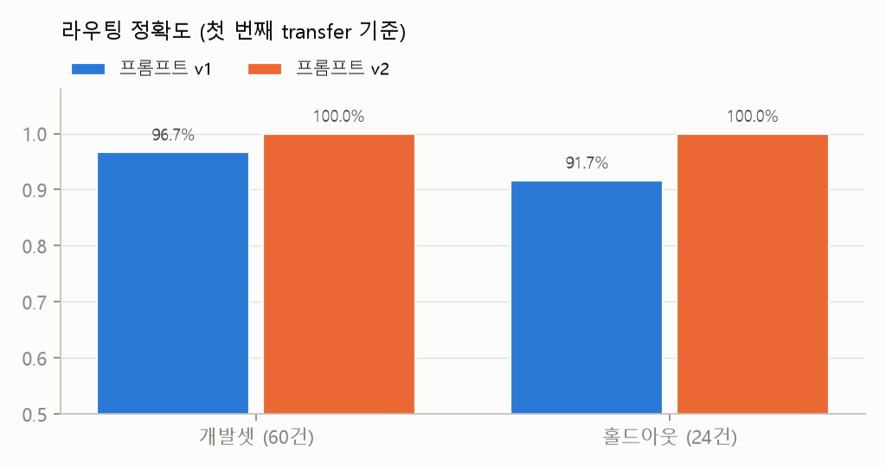
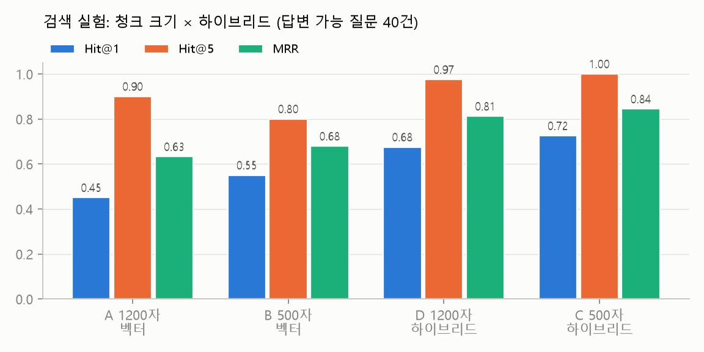
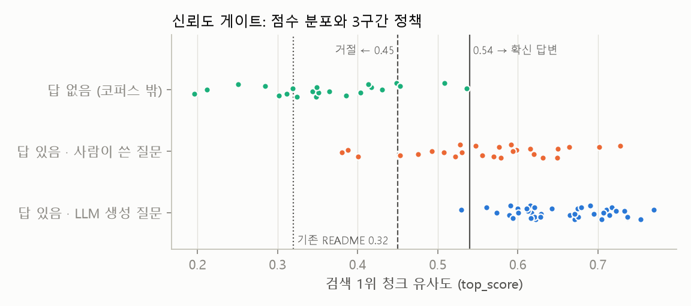

# 평가 리포트 — Industry-tailored Agents

> `python -m eval.make_report` 로 `eval/results/*.csv`에서 자동 생성됩니다. 모든 API 응답은 `eval/cache/`에 저장되어 재실행 시 비용 0으로 같은 수치가 재현됩니다.
> LLM: Claude Sonnet 5.5 (`claude-sonnet-5-5`) · 임베딩: OpenAI `text-embedding-3-small`

## 1. 라우팅 — 질의를 올바른 에이전트로 보내는가

- 정답 라벨 60건(개발셋: easy 33 / hard 21 / ambiguous 6) + **프롬프트 개선 후 처음 평가한 홀드아웃 24건**
- 실제 오케스트레이터(ADK + Claude)를 그대로 실행하고, 서브에이전트는 스텁으로 대체해 라우팅만 측정. 질의당 3회 반복.

| split      | prompt   |   accuracy |   consistency |   hard+ambiguous |   n |   NONE(직접답변) |
|:-----------|:---------|-----------:|--------------:|-----------------:|----:|-------------:|
| 개발셋 (60건)  | v1       |      0.967 |         0.950 |            0.926 |  60 |            1 |
| 개발셋 (60건)  | v2       |      1.000 |         1.000 |            1.000 |  60 |            0 |
| 홀드아웃 (24건) | v1       |      0.917 |         0.917 |            0.867 |  24 |            1 |
| 홀드아웃 (24건) | v2       |      1.000 |         1.000 |            1.000 |  24 |            0 |

**v1 개발셋 혼동행렬**

| true \ pred   |   Day1WebAgent |   Day2RagAgent |   Day3GovAgent |   NONE |
|:--------------|---------------:|---------------:|---------------:|-------:|
| Day1WebAgent  |             20 |              0 |              0 |      0 |
| Day2RagAgent  |              1 |             19 |              0 |      1 |
| Day3GovAgent  |              0 |              0 |             19 |      0 |

**v2 홀드아웃 혼동행렬**

| true \ pred   |   Day1WebAgent |   Day2RagAgent |   Day3GovAgent |
|:--------------|---------------:|---------------:|---------------:|
| Day1WebAgent  |              8 |              0 |              0 |
| Day2RagAgent  |              0 |              8 |              0 |
| Day3GovAgent  |              0 |              0 |              8 |

## 2. RAG 검색 — 정답 근거를 찾아오는가

- 정답 기준: 질문마다 저장한 **근거 구절**이 검색된 청크에 포함되면 정답 (청크 경계가 달라져도 같은 정답셋으로 비교)
- D는 "청크 크기 효과"와 "하이브리드 효과"를 분리하기 위한 대조군

| exp   |   chunk_size |   chunk_overlap | hybrid   |   n_chunks |   n_answerable |   hit@1 |   hit@3 |   hit@5 |   mrr |
|:------|-------------:|----------------:|:---------|-----------:|---------------:|--------:|--------:|--------:|------:|
| A     |         1200 |             200 | False    |         76 |             40 |   0.450 |   0.800 |   0.900 | 0.632 |
| B     |          500 |             100 | False    |        189 |             40 |   0.550 |   0.800 |   0.800 | 0.679 |
| D     |         1200 |             200 | True     |         76 |             40 |   0.675 |   0.925 |   0.975 | 0.812 |
| C     |          500 |             100 | True     |        189 |             40 |   0.725 |   0.975 |   1.000 | 0.844 |

## 3. 신뢰도 게이트 — 언제 답하고 언제 거절하는가

- 문서에 답이 있는 질문 66건(LLM 생성 40 + 사람 작성 26), 없는 질문 22건으로 임계값을 스윕
- FP(답 없는데 통과) = 근거 없는 답변 위험 → FN보다 치명적으로 간주

| setting                       |   t_top |   t_mean |   precision |   recall |    f1 |   tp |   fp |   fn |   tn |
|:------------------------------|--------:|---------:|------------:|---------:|------:|-----:|-----:|-----:|-----:|
| code(0.20/0.20)               |   0.200 |    0.200 |       0.759 |    1.000 | 0.863 |   66 |   21 |    0 |    1 |
| readme(0.32/0.30)             |   0.320 |    0.300 |       0.835 |    1.000 | 0.910 |   66 |   13 |    0 |    9 |
| synthetic로만 선정(0.46) → 전체 데이터 |   0.460 |    0.000 |       0.969 |    0.939 | 0.954 |   62 |    2 |    4 |   20 |
| 단일 임계값 선정(0.45)               |   0.450 |    0.000 |       0.955 |    0.955 | 0.955 |   63 |    3 |    3 |   19 |
| 3구간: 확신 답변 구간만(T_HIGH=0.54)   |   0.540 |    0.000 |       1.000 |    0.833 | 0.909 |   55 |    0 |   11 |   22 |
| 3구간: 거절 제외 전체(T_LOW=0.45)     |   0.450 |    0.000 |       0.955 |    0.955 | 0.955 |   63 |    3 |    3 |   19 |

**채택한 3구간 정책별 분포**

| source    | answerable   |   answer |   refuse |   warn |
|:----------|:-------------|---------:|---------:|-------:|
| human     | False        |        0 |        2 |      0 |
| human     | True         |       16 |        3 |      7 |
| synthetic | False        |        0 |       17 |      3 |
| synthetic | True         |       39 |        0 |      1 |

## 4. 답변 생성 — 근거에 충실한가

- 운영 파이프라인(하이브리드 검색 → 게이트 → Claude 생성, 문장마다 [n] 인용) 그대로 실행
- 문장 단위 Faithfulness는 LLM 채점관 판정 → **채점관 자체를 사람 라벨로 검증(κ)**

| subset       |   n |   answer_rate(answerable) |   refusal_acc(unanswerable) |   refused_by_gate |   refused_by_llm |   faithfulness(sentence) |   fully_faithful_answers |   citation_validity |   citation_coverage |   answers_question |
|:-------------|----:|--------------------------:|----------------------------:|------------------:|-----------------:|-------------------------:|-------------------------:|--------------------:|--------------------:|-------------------:|
| all          |  88 |                     0.939 |                       1.000 |                22 |                4 |                    1.000 |                    1.000 |               1.000 |               0.943 |              1.000 |
| human        |  28 |                     0.846 |                       1.000 |                 5 |                1 |                    1.000 |                    1.000 |               1.000 |               0.979 |              1.000 |
| out_of_scope |  20 |                   nan     |                       1.000 |                17 |                3 |                  nan     |                  nan     |             nan     |             nan     |            nan     |
| synthetic    |  40 |                     1.000 |                     nan     |                 0 |                0 |                    1.000 |                    1.000 |               1.000 |               0.918 |              1.000 |

**채점관 민감도 검증 (음성 대조군)** — 실제 답변 문장에 사실 오류를 하나씩 주입했을 때 채점관이 잡아내는 비율.
Faithfulness가 1.0으로 나와 "같은 모델이 관대하게 채점한 것 아닌가"를 확인하기 위함.

|      n |   detection_rate |
|-------:|-----------------:|
| 15.000 |            1.000 |

**채점관 검증 (사람 라벨 vs LLM 채점관)** — 원문 10 + 오류 주입 10 문장을 섞어 사람이 블라인드 라벨링

|     n |   judge_vs_human_agreement |   cohen_kappa |   human_accuracy_vs_injected |   judge_accuracy_vs_injected |
|------:|---------------------------:|--------------:|-----------------------------:|-----------------------------:|
| 7.000 |                      0.714 |         0.462 |                        0.714 |                        1.000 |

- 20문장 중 사람이 라벨링을 마친 문장만 집계 (진행 중). 표본이 작아 κ 자체는 참고치.
- 불일치 2건은 모두 **오류 주입 문장인데 사람이 '근거 있음'으로 본 경우**(부정 반전 "책임을 질 수 있다→지지 않는다", 숫자 "세 단계→네 단계"). 채점관은 둘 다 잡았음.
- 즉 불일치의 원인은 채점관의 관대함이 아니라 사람의 놓침이었고, 미묘한 오류는 사람도 빠르게 읽으면 놓친다는 점에서 자동 채점의 가치를 보여 줌.

## 5. 규칙 기반 컴포넌트 수정

**Day1 티커 추출** (30건, API 호출 없음)

| version   |   precision |   recall |   exact_match |   false_positive_queries |   n |
|:----------|------------:|---------:|--------------:|-------------------------:|----:|
| before    |       0.371 |    0.867 |         0.400 |                       16 |  30 |
| after     |       0.938 |    1.000 |         0.967 |                        1 |  30 |

**Day3 공고 마감일 추출** (20건, API 호출 없음 · 규칙 개발에 사용한 세트라 낙관적 수치)

| version   |   fill_rate |   accuracy_when_present |   false_extractions |   n_with_deadline |   n_without |
|:----------|------------:|------------------------:|--------------------:|------------------:|------------:|
| before    |       0.000 |                   0.000 |                   0 |                15 |           5 |
| after     |       1.000 |                   1.000 |                   0 |                15 |           5 |

## 6. 한계와 다음 단계

- **표본 크기**: 라우팅 84건, RAG 88건. 1건 = 1.2~1.7%p라 소수점 차이는 의미가 작음. 100% 수치는 "이 세트에서 오류 0건"이지 완벽하다는 뜻이 아님.
- **홀드아웃의 독립성**: 라우팅 홀드아웃은 v1 오류 패턴을 본 뒤 같은 작성자가 만든 세트. 실제 사용자 로그로 재검증 필요.
- **LLM 생성 질문의 낙관 편향**: 원문 표현과 겹쳐 검색·게이트 점수가 높게 나옴 → 사람이 쓴 질문 28건을 따로 넣어 임계값을 정했고, 그 결과 사람 질문의 답변률은 84.6%로 LLM 생성 질문(100%)보다 낮음.
- **게이트 FN**: 약어(PCCP)나 '자료에서 ~ 찾아줘' 같은 질의는 dense 점수가 낮아 거절됨. 게이트에 BM25 점수를 함께 쓰는 방안이 다음 과제.
- **채점관**: 생성 모델과 같은 모델(Sonnet 5.5). 음성 대조군 + 사람 라벨 κ로 보완하지만, 다른 모델 채점관과의 교차 검증은 미실시.
- **Day3 마감일 추출**: 규칙을 만들며 본 20건으로 측정 → 실제 수집 데이터에서의 채움률은 별도 측정 필요.
- **Day1 티커**: "SK하이닉스"의 SK처럼 한글 회사명 접두어 오인식 1건 잔존.
